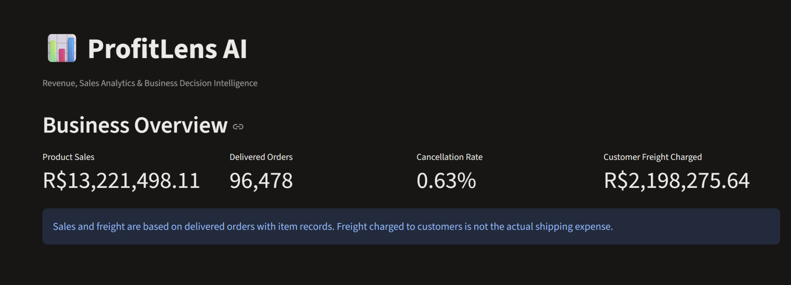
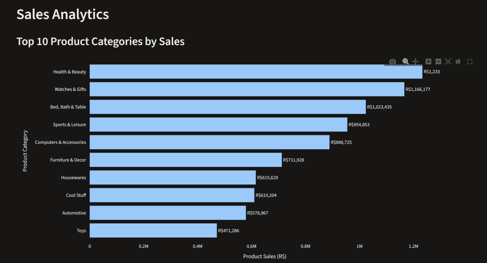
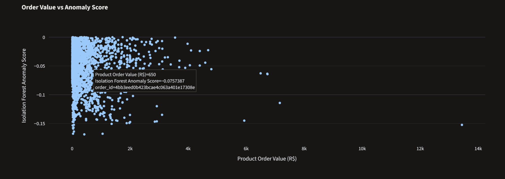
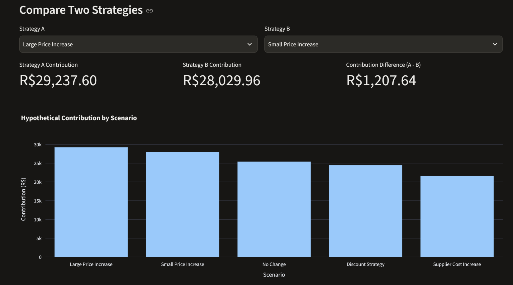
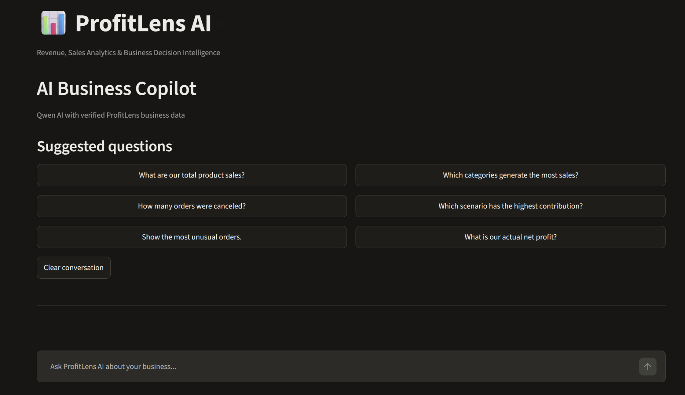
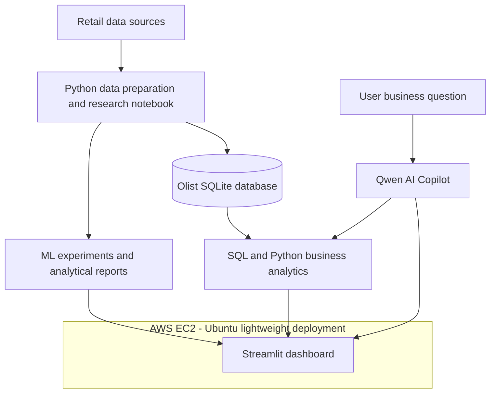

# ProfitLens AI
### Retail & E-commerce Intelligence | Data Analytics, Machine Learning & AI

     

ProfitLens AI is an end-to-end data science portfolio project that transforms historical retail and e-commerce data into business insights. It integrates SQL analytics, machine learning, financial scenario modeling and an interactive Streamlit application, with a lightweight dashboard successfully deployed and tested on AWS EC2.

**Project status:** Functional research and portfolio prototype | Analytics dashboard deployed and tested on AWS EC2 | Recorded application demo available. The AI Copilot requires a separate, adequately provisioned environment.

## Application demo

Watch a silent, screen-recorded walkthrough of the application. The recording demonstrates the user interface without requiring access to the cloud server.

[](https://youtu.be/EPehgyq9u04)

**[Watch the application demo on YouTube](https://youtu.be/EPehgyq9u04)**

The recording is available independently of the AWS instance. A permanent public live endpoint is not currently configured.

## Dashboard preview

Actual screenshots from the ProfitLens AI application. All monetary values are in Brazilian reais (R$).

### Executive business dashboard



The dashboard displays R$13,221,498.11 in product sales, 96,478 delivered orders, a 0.63% cancellation rate and R$2,198,275.64 in customer freight charged. Sales and freight are based on delivered orders with item records; freight charged is not actual shipping expense.

### Product category performance



Compare category-level sales to identify leading product segments and support merchandising decisions.

### Machine learning-based anomaly detection



Explore unusual order observations using Isolation Forest scores and interactive chart details. Flags are investigation signals, not confirmed fraud.

### What-if business scenario analysis



Compare hypothetical pricing and cost strategies. In the illustrated scenario, the large price increase produces R$29,237.60 in modeled contribution versus R$28,029.96 for the small price increase, a difference of R$1,207.64. These are assumption-based estimates, not realized profit or a recommendation to increase prices.

### AI Business Copilot (local application preview)



The Copilot provides a conversational interface for exploring sales, cancellations, product categories, unusual orders and hypothetical strategy outcomes. It combines Qwen with approved business analytics tools. This screenshot demonstrates the interface, not a verified answer or a working cloud-hosted chatbot. The Copilot is not operational on the current AWS instance.

## Project highlights

| Area | Implementation |
|---|---|
| Data engineering | Retail data preparation, relational storage and SQL-based reporting |
| Business analytics | Sales trends, product and category performance, freight and order analysis |
| Machine learning | Isolation Forest anomaly detection and time-aware sales forecasting experiments |
| Financial modeling | Assumption-based what-if analysis |
| Generative AI | Qwen 2.5 1.5B Instruct with approved Python/SQL business tools |
| Application development | Interactive Streamlit dashboard |
| Cloud deployment | AWS EC2, Ubuntu, Python virtual environment and security groups |

## Business problem

Retail managers need to understand what drives sales, identify unusual orders, anticipate future demand and evaluate potential financial decisions. These questions often require separate reports, manual analysis and repeated data preparation.

ProfitLens AI brings these activities into one analytical workflow, helping users explore historical performance, investigate unusual observations and compare hypothetical business scenarios.

## Dashboard features

| Module | Business application |
|---|---|
| Business Overview | Monitor high-level sales and order indicators |
| Sales Analytics | Identify sales trends and product/category performance |
| Anomaly Detection | Prioritize unusual orders for further investigation |
| Financial What-If Simulator | Explore the modeled effects of changes in price, volume and costs |
| AI Business Copilot | Ask supported business questions using approved analytical tools |

Forecasting experiments are documented in the research notebook. Dashboard modules and the AI component have different deployment requirements.


## System architecture



The diagram represents the logical project architecture. The Qwen Copilot is a separate AI capability and is not running on the current EC2 deployment.

## Data sources

| Dataset | Research purpose |
|---|---|
| [Olist Brazilian E-commerce](https://www.kaggle.com/datasets/olistbr/brazilian-ecommerce) | Core order, product, customer, payment and category analytics; application database |
| [Walmart M5](https://www.kaggle.com/competitions/m5-forecasting-accuracy) | Retail sales and demand exploration |
| [UCI Online Retail II](https://archive.ics.uci.edu/dataset/502/online+retail+ii) | Transaction-level retail exploration |
| dunnhumby The Complete Journey | Promotional and customer analytics exploration |

These datasets are separate research sources, not combined financial records from one company. The application uses a reduced Olist-derived SQLite database. Not all raw datasets are included; consult their original licensing terms before redistribution.

## Data science methodology

### SQL and exploratory analytics

Python, Pandas and SQLite are used to prepare data, calculate business indicators, explore monthly trends, analyze product and category sales, and cross-check aggregated totals. Sales revenue is not treated as net profit because complete cost and refund information is unavailable.

### Anomaly detection

Isolation Forest identifies unusual order-level observations. Business investigation rules, explanations and priority labels help interpret model flags. These flags are investigation signals, not confirmed fraud.

### Sales forecasting

The research notebook compares baseline and machine learning forecasting methods using historical monthly sales, lag features and rolling averages. Time-aware evaluation is used to avoid randomly mixing future observations into training.

| Evaluation highlight | Saved notebook result |
|---|---|
| Lowest reported MAE in one comparison | R$ 41,682.46 |
| Model in that comparison | Naive baseline |
| Metric | Mean Absolute Error (lower is better) |

This result applies to one saved experimental comparison, not a universal model ranking. The short, irregular time series limits forecast reliability. The result demonstrates why simple baselines should be evaluated before selecting more complex models.

### Financial what-if analysis

The simulator compares hypothetical changes to business assumptions and ranks modeled outcomes. Estimated contribution is based on assumptions and does not represent audited net profit.

### AI Business Copilot

The project uses `Qwen/Qwen2.5-1.5B-Instruct` to help interpret supported business questions. Approved Python and SQL analytics tools supply business figures. The design includes checks intended to reject unsupported profitability or simulation requests rather than invent financial numbers.

#### Copilot development and deployment challenges

- **API access and cost:** Earlier API-based experiments encountered rate-limit errors. An open-weight Qwen model was explored to reduce dependence on paid API calls, but local inference still requires computing resources.
- **GPU and memory:** Limited GPU availability constrained experimentation. The 1.5-billion-parameter model requires memory for model weights, inference and supporting libraries; the 1 GiB EC2 instance is not adequately provisioned for the current implementation.
- **Observed deployment error:** Selecting the Copilot on AWS raised `ModuleNotFoundError: No module named 'torch'`. PyTorch and other large AI dependencies had intentionally been omitted from the lightweight installation. The error establishes a missing dependency, not a measured out-of-memory failure.
- **Engineering trade-off:** Rather than install the full AI stack or upgrade the instance and consume additional cloud credits, the analytics dashboard was retained as the working AWS deployment. The Copilot remains a separate capability requiring a suitable environment.
- **Answer reliability:** Business figures should come from verified SQL/Python outputs. Missing cost data prevents calculation of actual net profit; the assistant should disclose that limitation instead of inventing a figure. Incomplete cancellation item records also restrict product-level conclusions. Comprehensive answer-accuracy, latency and memory benchmarks remain future work.
- **Future approach:** Separate AI inference from the dashboard, evaluate smaller or quantized models, consider a budget-controlled inference service, and test response accuracy and resource usage before enabling cloud access.

## Technology stack

| Layer | Technologies |
|---|---|
| Programming and data processing | Python, Pandas, NumPy |
| Database | SQL, SQLite |
| Machine learning | scikit-learn |
| Visualization | Plotly, Matplotlib |
| Application | Streamlit |
| Generative AI | Qwen, PyTorch, Hugging Face Transformers |
| Development | Jupyter Notebook, Google Colab, Git, GitHub |
| Deployment | AWS EC2, Ubuntu, Docker configuration |

## AWS cloud deployment

The Streamlit dashboard was deployed and tested on an Ubuntu-based AWS EC2 instance.

| Configuration | Details |
|---|---|
| Cloud service | Amazon EC2 |
| Operating system | Ubuntu 24.04 LTS |
| Instance type | t3.micro (2 vCPU, 1 GiB RAM) |
| Storage | 20 GiB gp3 EBS |
| Region | US East (Ohio), us-east-2 |
| Application port | 8501 |
| Network access | AWS security group with restricted inbound access |
| Environment | Python 3.12 virtual environment |

Deployment involved provisioning the server, cloning the GitHub repository, configuring Python dependencies, starting Streamlit, managing inbound network access and verifying HTTP connectivity.

**Deployment limitation:** The analytics dashboard pages were tested successfully. The AI Business Copilot raised `ModuleNotFoundError: No module named 'torch'` because the lightweight AWS environment excludes the large AI dependencies. The 1 GiB instance is also unsuitable for the current model configuration; no cloud inference benchmark was performed. The server is intended for controlled demonstrations and can be stopped to conserve credits. The current IP-based HTTP endpoint is not a permanent public portfolio link.

## Repository structure

```text
ProfitLens-AI/
├── ProfitLens_AI.ipynb
├── database/
│   └── profitlens_olist.db
├── reports/
│   ├── anomalies/
│   └── decisions/
├── streamlit_app/
│   ├── app.py
│   ├── config.py
│   ├── requirements-deploy.txt
│   └── utils/
│       ├── copilot_core.py
│       ├── copilot_service.py
│       └── qwen_loader.py
├── screenshots/          # Dashboard preview images
├── Dockerfile
├── requirements.txt
└── README.md
```

## Getting started

### 1. Clone the repository

```bash
git clone https://github.com/kirshanchand/ProfitLens-AI.git
cd ProfitLens-AI
python -m venv .venv
```

### 2. Activate the environment

Windows (Command Prompt):

```bat
.venv\Scripts\activate
```

Linux/macOS:

```bash
source .venv/bin/activate
```

### 3. Install dependencies and launch

```bash
python -m pip install -r requirements.txt
python -m streamlit run streamlit_app/app.py
```

Open `http://localhost:8501` in your browser. Full AI installation requires compatible Python/PyTorch versions, sufficient RAM and internet access for the initial model download. Cross-platform installation has not been fully validated.

### Lightweight AWS dashboard

The tested EC2 setup installed the following dashboard dependencies without the large AI packages:

```bash
python -m pip install streamlit==1.67.0 pandas==2.2.3 numpy==2.4.6 plotly==5.24.1 scikit-learn==1.6.1
python -m streamlit run streamlit_app/app.py --server.address 0.0.0.0 --server.port 8501 --server.headless true
```

Use a restricted security group and avoid sensitive information over HTTP. The AI Copilot will not work with this lightweight installation. Docker and Hugging Face Spaces configuration are included, but a working public Space is not confirmed.

## Engineering challenges, limitations and lessons learned

Developing this project required balancing business requirements, data availability, model reliability and infrastructure costs. The following constraints shaped the implementation and identify opportunities for further development.

| Challenge | Impact and response |
|---|---|
| Data acquisition | Finding accessible, realistic retail datasets with sufficient historical coverage and financial detail was difficult. Multiple public research sources were explored; Olist was selected as the core application database. |
| Incomplete financial information | Public transaction records do not provide all costs, refunds, margins and inventory information needed for a complete profit-and-loss system. Revenue is reported separately from profit; financial scenarios use explicit assumptions. |
| Data quality and relationships | Missing observations and incomplete product-level records can distort aggregated results. Data preparation and reconciliation checks help reduce this risk; incomplete cancellation records limit product-level conclusions. |
| Forecasting reliability | Short and irregular monthly histories restrict training and evaluation. Baseline comparisons and time-aware evaluation are more informative than relying on model complexity alone. Results should not be generalized to unseen retailers. |
| GPU and memory availability | Access to GPU resources for experimentation was limited. Local and notebook environments have different resource constraints; the Qwen model and PyTorch stack require substantially more resources than the analytics dashboard. |
| Cloud resource constraints | The selected EC2 t3.micro instance has 1 GiB RAM. Large AI dependencies were deliberately excluded from the lightweight deployment to avoid unnecessary resource consumption. The dashboard works, but the Copilot is not operational on that instance. |
| Deployment cost and availability | AWS trial credits are finite. The instance can be stopped between demonstrations to conserve compute credits; storage and other resources may still incur charges. The current IP-based endpoint is not a stable public service. A recorded demo provides an alternative for portfolio review. |
| AI reliability | Language model responses may be incorrect or unsupported. The Copilot uses approved analytical tools and checks, but its accuracy and robustness have not been comprehensively benchmarked. |
| Reproducibility | External dataset downloads, Google Drive paths, model downloads and platform-specific dependencies may require configuration. Full cross-platform reproduction and Docker deployment have not been independently validated. |

### Responsible interpretation

- Anomaly scores indicate observations for investigation, not confirmed fraud.
- Forecasts are experimental estimates, not guaranteed future revenue.
- What-if outcomes are assumption-based, not audited financial results.
- AI-generated explanations should be checked against the underlying SQL and analytical outputs.
- Dataset licenses and redistribution permissions should be reviewed before commercial use.

### Lessons learned

The project demonstrates the importance of defining measurable business questions before modeling, validating data joins and totals, comparing simple forecasting baselines with more complex models, and matching deployment resources to application requirements. It also illustrates why separating lightweight analytics from resource-intensive AI is useful when operating under a limited cloud budget.

## Future development roadmap

| Priority | Improvement | Expected benefit |
|---|---|---|
| High | Add automated data validation and regression tests | More reliable metrics and safer updates |
| High | Expand historical coverage and obtain verified cost and inventory data | Stronger forecasting and more meaningful profitability analysis |
| High | Improve rolling time-series evaluation and uncertainty reporting | Better understanding of forecast reliability |
| Medium | Separate the Copilot from the dashboard and benchmark memory, latency and answer accuracy | More efficient and reliable AI integration |
| Medium | Validate dependency installation and Docker builds across environments | Easier reproduction and deployment |
| Medium | Add secure HTTPS hosting, access controls and operational monitoring | A more stable public demonstration, subject to budget |
| Optional | Expand portfolio documentation and add further walkthroughs | Easier project review |

These are proposed improvements, not completed production features.

## Author

**Kirshan Chand**  
Master's in Data Science | Finance background  
Data Science · Data Analytics · Business Analytics · Machine Learning

[GitHub Profile](https://github.com/kirshanchand)

---
*Built as a data science portfolio project connecting business analysis, machine learning, generative AI and cloud deployment.*
